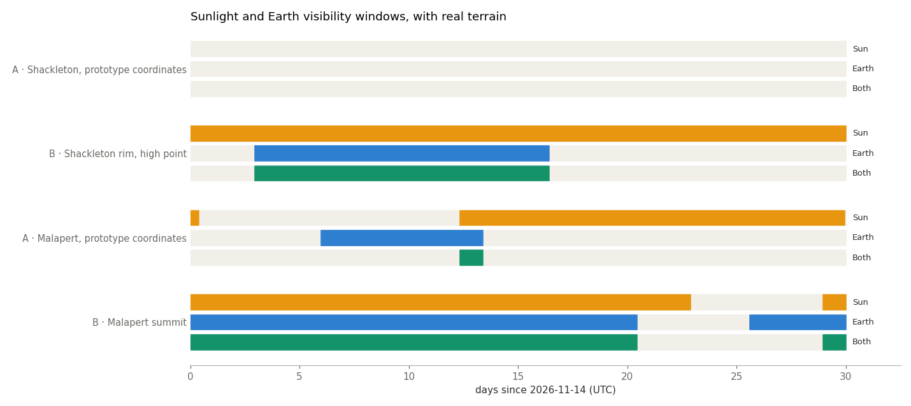

# ASTRA-SN — Lunar Landing Site Navigator

NASA Space Apps Challenge 2026 · Team ASTRA-SN (Dakar, Senegal)

**If my mission slips, where and when can I still land — and why?**
ASTRA-SN shows, for a site near the lunar south pole and a mission period, when the Sun
and the Earth are above the *real* terrain horizon, using NASA LOLA elevation data.

> Status: hackathon work in progress. The scientific engine is validated (see below);
> the API and the web application are being built.

## What is validated today

| Check | Reference | Result |
|---|---|---|
| Sun and Earth azimuth / elevation | JPL Horizons, 4 sites × 30 days | max 15 arcsec (0.004°) |
| Terrain horizon mask | NASA polar illumination maps (Mazarico et al. 2011) | Sun within ±2 points; Earth +2 to +6 points (open issue) |

Details: [docs/scientific/test_results.md](docs/scientific/test_results.md).



## Repository layout

| Folder | Owner | Content |
|---|---|---|
| [`backend/`](backend/) | Pole 2 — engine & app | `astra_engine` Python package (ephemeris, horizon, visibility), scripts; FastAPI to come |
| [`contract/`](contract/) | shared | JSON format exchanged between engine and frontend, with **real example files** |
| [`frontend/`](frontend/) | Pole 3 — UX | web application (to be created) |
| [`validation/`](validation/) | Pole 1 — science | scripts comparing the engine with JPL Horizons and NASA maps, cached results |
| [`data/`](data/) | shared | site catalogue; inventory of LOLA files (large files are **not** in Git) |
| [`docs/`](docs/) | all | scientific documentation, project notes, submission texts (Pole 4) |

**Working in parallel:** the frontend can be built now from
[`contract/examples/`](contract/examples/) without waiting for the API.

## Quick start (engine)

```bash
cd backend
python -m venv .venv && .venv/Scripts/activate      # Windows; on macOS/Linux: source .venv/bin/activate
pip install -r requirements.txt
python scripts/run_sites.py <path/to/LDEM_80S_80MPP_ADJ.tiff> ../outputs
python scripts/plots.py <path/to/LDEM_80S_80MPP_ADJ.tiff> ../outputs
```

Where to get the LOLA file: [data/README.md](data/README.md).

## Conventions

UTC times · degrees · azimuth 0° = north, clockwise · negative elevation = below the
horizontal plane · south latitude negative · east longitude from −180° to 180°.

## Team workflow

- `main` is protected by convention: work on a branch (`feat/...`, `fix/...`, `docs/...`), open a pull request.
- Never commit large data (`*.tif`, `*.tiff`) — see `.gitignore`.
- Every document in this repository is written in English.

## Data and credits

NASA LOLA (PGDA), JPL Horizons, NASA polar illumination maps; astronomy-engine (MIT).
Full list: [docs/submission/references.md](docs/submission/references.md).
AI use is disclosed in [docs/submission/ai_usage.md](docs/submission/ai_usage.md).
